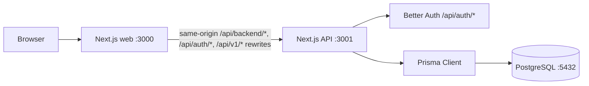

# Jelenlegi architektúra

Utolsó ellenőrzés: 2026-10-26
Állapot: a fiók/munkamenet, háztartás, meghívókiadás/-elfogadás és T07 tagságkezelés kódja megvalósult a munkabranchben; a T07 kézi ellenőrzése még folyamatban van. A főkönyv és a későbbi pénzügyi funkciók még hiányoznak.

Ez a dokumentum a repository jelenlegi állapotát írja le. A tervezett, de még nem elkészült részek külön jelölést kapnak, hogy későbbi módosításkor látható legyen, mi a tényleges architektúra.

## Repository-struktúra

```text
family_finance/
├── .agents/
│   └── skills/              Projekt-szintű Codex skillek
├── .codex/
│   ├── config.toml          Codex subagent concurrency configuration
│   └── agents/              Projekt-szintű architect, tester, reviewer, developer, designer, product-owner és git-workflow agentek
├── AGENTS.md               Shared project rules for coding agents
├── apps/
│   ├── web/                 Next.js webalkalmazás
│   └── api/                 Next.js API és hitelesítési végpontok
├── packages/
│   └── shared/              Kliensbiztos API-státusz szerződés és ellenőrzés
├── product-owner/
│   └── epics/               Termékepikek, taskokra bontás előtt
├── docs/                    Architektúra- és fejlesztői dokumentáció
├── skills-lock.json         A projekt-szintű skillek forrás- és hash-lockja
├── Dockerfile               Közös image-leírás, APP build argumentummal
├── docker-compose.yml       Web, API és PostgreSQL szolgáltatások
├── package.json             Workspace-szintű parancsok és verziók
├── pnpm-lock.yaml           Közös függőségi lockfile
└── pnpm-workspace.yaml      pnpm workspace beállítás
```

## Alkalmazások és adatfolyam



- A web és az API külön Next.js alkalmazásként és külön Compose-szolgáltatásként van beállítva.
- A web főoldalán backend-kapcsolatjelző van, amely a `/api/backend` útvonalon ellenőrzi az API állapotát.
- Az API és a web a `@household-finance/shared` csomag közös `BackendStatusResponse` típusát használja; a web a hálózati JSON-t a csomag kliensbiztos ellenőrző függvényével validálja.
- A web Next.js rewrite-ja az `/api/backend/*`, `/api/auth/*` és `/api/v1/*` kéréseket az API-ra továbbítja. Fejlesztéskor az alapcél `http://localhost:3001`; Compose alatt az `API_INTERNAL_URL=http://api:3001` érvényesül.
- A same-origin proxy elkerüli a böngésző CORS-korlátozását, és a Better Auth munkamenet-sütije a web originjén működik. Az API állapotvégpontja a `/` útvonalon, a Better Auth végpontjai a `/api/auth/*` alatt találhatók.
- A jelenleg CSRF-ellenőrzött, cookie-munkamenetes módosító útvonalak (`POST /api/v1/households`, a háztartás `PATCH`, valamint a meghívók `POST` és `DELETE`) a `WEB_ORIGIN`-nel egyező `Origin` fejlécet és `application/json` tartalomtípust követelnek meg. Hiányzó vagy érvénytelen `WEB_ORIGIN` esetén a módosítás zártan elutasított; az olvasó `GET` kérésekre ez az ellenőrzés nem vonatkozik. A Better Auth konfigurációjában használt helyi alapértelmezés nem helyettesíti ezt az API-korlátot: a `WEB_ORIGIN`-t be kell állítani.
- A web a Better Auth 1.7.12 React kliensével regisztrál, jelentkeztet be és ki, valamint ellenőrzi a munkamenetet. Az API `GET /api/v1/me` végpontja a szerveroldali munkamenetből adja vissza a felhasználó alapadatait, vagy 401-et ad hitelesítés nélkül. A böngésző által küldött `userId` nem szolgál azonosításként.
- Az API `GET` és `POST /api/v1/households` végpontjai a Better Auth szerveroldali munkamenetéből veszik a felhasználóazonosítót. A listavégpont csak a felhasználó tagságait adja vissza. A létrehozás egy Prisma-tranzakcióban menti a háztartást, az első `OWNER` tagságot és a kilenc alapértelmezett kategóriát; a pénznem `RON`, más pénznemű kérés elutasításra kerül.
- A későbbi, háztartásazonosítót célzó API-útvonalak újrahasználhatják az `authorizeHouseholdOperation` segédet. Minden híváskor a Better Auth munkamenetből származó felhasználóhoz friss `HouseholdMember` rekordot keres: munkamenet nélkül `401`, nemlétező vagy nem taghoz tartozó háztartásnál egységes `404`, a művelethez kevés szerepkörnél `403` a válasz. A `read` műveletet mindhárom (`OWNER`, `MEMBER`, `VIEWER`), a `financial-write` műveletet `OWNER` és `MEMBER`, a `manage` műveletet csak `OWNER` végezheti. A jelenlegi háztartáslista/létrehozás útvonalak továbbra is saját, munkamenet-alapú tagságszűrést használnak, mert nincs bennük cél-háztartásazonosító.
- A web bejelentkezés után a tagságlistából kínál háztartás-kiválasztást. A kiválasztott háztartás azonosítója `household-selection:v1` kulccsal, minimális böngészőoldali preferenciaként tárolódik; ez nem jogosultsági adat, a szerveroldali API mindig a munkamenet és tagság alapján ellenőriz.
- Az API `GET /api/v1/households/[householdId]` útvonala a `read` policyval friss tagságot ellenőriz, majd a háztartás nevét, RON pénznemét és a munkamenethez tartozó szerepet adja vissza. A `PATCH` ugyanazon az útvonalon `manage` jogosultságot kér, csak az 1–100 karakteres nevet fogadja el; a nem támogatott mezőket, így a `currency` módosítását is elutasítja. Mindkét válasz `Cache-Control: no-store` fejlécet kap.
- A háztartás panel a kiválasztott háztartás nevét, pénznemét és a tagságlistából származó szerepét mutatja; átnevező űrlapot csak `OWNER` szerepnél jelenít meg. Mentéskor az API szerveroldali policyja az irányadó, a panel pedig frissíti a nevet a sikeres válasz alapján. A pénznem rögzített `RON`, nincs pénznemválasztó.
- Az EPIC-02-T05 `HouseholdInvitation` Prisma-modellje és migrációja helyi fejlesztésben alkalmazva van. A háztartás alatti meghívó kiíró/listázó és visszavonó útvonalak a friss `manage` policyt használják, ami csak az `OWNER` szerepet engedi; 7 napos lejáratot, normalizált tájékoztató e-mail-címet, `MEMBER`/`VIEWER` szerepet, egyszer használatos véletlen tokent és adatbázisban csak SHA-256 token hash-t alkalmaznak. A nyers link csak a létrehozás válaszában szerepel; a függő meghívók listája nem adja vissza. A meghívólink alapcíme kötelező `WEB_ORIGIN` konfigurációból származik, és csak hiteles HTTP(S) origin lehet felhasználónév/jelszó, útvonal, query vagy fragment nélkül; nem-loopback hosztnál HTTPS kötelező, sima HTTP csak `localhost`, `127.0.0.1` vagy IPv6 `::1` loopback címen fogadható el. Hiányzó vagy hibás konfiguráció esetén a meghívás fail-closed módon elutasított, létrehozott meghívó és token nélkül. A kézi API- és felületellenőrzés szintetikus adatokkal sikeres volt.
- A web háztartás panelje a kiválasztott háztartáshoz kapcsolja az OWNER meghívókezelő felületet; szerep- vagy háztartásváltáskor a klienskomponens új példányként indul, ezért az egyszer megjelenő link állapota nem kerül át másik háztartáshoz vagy szerephez.
- Az EPIC-02-T06 meghívóelfogadó API-ja tokenből SHA-256 hasht készít, azonosítja a függő, le nem járt meghívót, majd egy tranzakcióban feltételesen elfogadott állapotba állítja és létrehozza a meghívott `MEMBER`/`VIEWER` tagságot. Már tag felhasználó `409` választ kap, a tagsága és szerepe nem változik, a meghívó pedig függő marad. A megosztott URL a tokent a `#token=` fragmentumban hordozza, amelyet a böngésző nem küld el a webkiszolgálónak; az elfogadóoldal a fragmentumot kliensoldalon olvassa és azonnal eltávolítja az előzményből. Az oldal `no-referrer` szabályt használ, és ugyanazon az oldalon biztosít bejelentkezést/regisztrációt, a tokent pedig nem tárolja böngészőtárban. Szintetikus kézi ellenőrzés igazolta a MEMBER/VIEWER elfogadást, a már tag 409-et, a token visszajátszását, visszavont/érvénytelen linket, egyidejű duplikált elfogadást és a token URL-ből eltávolítását; a lejárt link esete még ellenőrizetlen.
- Az EPIC-02-T07 `GET /api/v1/households/[householdId]/members` végpontja mindhárom szerepnek neveket és szerepeket ad; teljes e-mail-címeket csak az OWNER és az érintett tag kap. Az OWNER eltávolíthat másik tagot, saját kilépés a `DELETE .../members/me` végponton történik. Az egyedüli OWNER a kilépési kérésben megad egy meglévő MEMBER/VIEWER azonosítót; a céltag OWNER-ré előléptetése, az OWNER kiléptetése és a két audit-esemény ugyanabban a serializable tranzakcióban történik. Külön szerepmódosító végpont vagy szerepválasztó nincs. Az OWNER-számot érintő eltávolítás és kilépés serializable tranzakcióval védi az utolsó OWNER invariánst; ütközéskor `409` a válasz. A `HouseholdMemberAuditEvent` a háztartás, aktor, cél, művelet, előző/új szerep és időpont azonosítóit tárolja; a háztartás törlése a naplót is törli, e-mailt és tokent nem tárol. A tag API és UI kódja statikus ellenőrzést kapott; a szintetikus kézi ellenőrzés még függőben van.
- A Better Auth nyilvános base URL-je és engedélyezett originje a `WEB_ORIGIN` értékéből származik (`http://localhost:3000` alapértelmezés), mert a böngésző az auth végpontot a web proxyn keresztül éri el. Az API belső címe ettől független.
- A böngésző nem kapcsolódik közvetlenül a PostgreSQL-hez. Az adatbázis-hozzáférés az API feladata.
- Nincs beállítva reverse proxy. A Compose-portok jelenleg csak a localhost interfészre vannak kötve.

## Technológiák és verziók

| Elem | Beállított verzió | Használat |
|---|---:|---|
| Node.js | 24.22.1, `.nvmrc` szerint; Dockerben `node:24-alpine` | Fejlesztés és futtatás |
| pnpm | 11.25.0 | Workspace és függőségek |
| Docker Engine | 28.4.0 | Konténerfuttatás a fejlesztői gépen |
| Docker Compose | 2.39.2-desktop.1 | Helyi web, API és PostgreSQL szolgáltatások |
| Next.js | 16.4.3 | Web és API |
| React | 19.3.0 | Web UI |
| TypeScript | 5.9.3 | Web, API és közös csomag |
| ESLint | 9.39.5 | Web, API és közös TypeScript-forrás lintelése |
| Tailwind CSS | 4.3.3 | Web stílusok PostCSS-feldolgozással |
| Prisma ORM | 7.10.1 | API adatbázis-hozzáférés és migrációk |
| Prisma CLI | 7.10.1 | Sémaellenőrzés, kliensgenerálás és migrációk |
| PostgreSQL driver adapter | `@prisma/adapter-pg` 7.10.1 | Prisma kapcsolat PostgreSQL-hez |
| PostgreSQL driver | `pg` 8.23.1 | Node.js PostgreSQL kapcsolat |
| Better Auth | 1.7.12 | API hitelesítés és webes React kliens email/jelszóval |
| Better Auth CLI | 1.7.12 | Auth séma generálása és ellenőrzése |
| Better Auth Prisma adapter | 1.7.12 | Auth-adatok tárolása Prisma segítségével |
| PostgreSQL image | 17-alpine | Compose adatbázis |

## Codex agentek és skillek

- A repository-szintű közös szabályok az `AGENTS.md` fájlban vannak.
- A `.codex/agents/` hét projektagentet tartalmaz: `architect`, `tester`, `reviewer`, `developer`, `designer`, `product_owner` és `git_workflow`. A szerepkörök és munkaszabályok agentenként a megfelelő TOML fájlban találhatók. A `reviewer` csak olvas, és kiemelten vizsgálja a biztonsági kockázatokat.
- A projekt-szintű, megosztott skillek az `.agents/skills/` alatt vannak; a `skills-lock.json` a külső forrásból telepített skillek forrását és tartalomhashét rögzíti. A `product-research` projektben karbantartott skill.
- A Codex multi-agent beállítás sessionönként legfeljebb hét párhuzamos subagentet enged.
- Az epic/task azonosítókhoz kötött branch-, commit- és PR-szabályokat a `docs/branching-strategy.md` írja le.

## Perzisztencia és konfiguráció

- A Compose `postgres` szolgáltatása a `postgres_data` nevű kötetet használja.
- A `DATABASE_URL` és a Better Auth beállításai a repository gyökerében lévő `.env` fájlból származnak. A `.env.example` csak minta; a titkos kulcsot helyben kell generálni.
- A Prisma konfiguráció az `apps/api/prisma.config.ts` fájlban van. A séma az `apps/api/prisma/schema.prisma` fájlban, a migrációk az `apps/api/prisma/migrations/` könyvtárban találhatók.
- A Prisma Client generált fájljai az `apps/api/src/generated/prisma/` könyvtárba kerülnek; ez a könyvtár Git-ignore alatt van.
- A séma a Better Auth `User`, `Session`, `Account` és `Verification` modelljei mellett tartalmazza a `Household`, `HouseholdMember` és `ExpenseCategory` modelleket, valamint a `HouseholdRole` enumot. Az elfogadott szerepek `OWNER`, `MEMBER` és `VIEWER`; a szerepcserélő migráció a korábbi `ADMIN` tagságokat `OWNER`-ré alakítja. A háztartások pénzneme alapértelmezetten `RON`; az API ezen kívül nem fogad el más pénznemet.
- Az `init`, `20261026074859_add_households` és `20261026101718_restrict_household_roles` migráció létrejött; mind alkalmazva lett a helyi PostgreSQL-adatbázisra.
- Fájlok privát tárolása, feltöltési kötet és mentési folyamat még nincs beállítva.

## Fejlesztői és konténeres indítás

- `./scripts/dev.sh` — ellenőrzi a Node.js, pnpm, Python 3 és Docker előfeltételeket, előkészíti a helyi `.env`-et, elindítja a PostgreSQL-t, ellenőrzi és alkalmazza a migrációt, majd indítja a webet `:3000` és az API-t `:3001` porton.
- `pnpm dev` — a web `:3000` és az API `:3001` indítása, ha az adatbázis és a migráció már készen áll.
- `pnpm build` — az API Turbopack-, majd a web Webpack-alapú production buildje. Mindkettő a közös TypeScript-forrást használja; a `packages/shared` csomagnak nincs külön build kimenete. A web buildje a Google Fonts letöltéséhez hálózatot igényel.
- `pnpm lint` — a web Next.js ESLint-ellenőrzése, majd az API és a `packages/shared/src` TypeScript ESLint-ellenőrzése; a generált Prisma-kód és Next.js buildkimenet kizárt.
- `pnpm typecheck` — külön TypeScript-ellenőrzés a `packages/shared`, `apps/api` és `apps/web` csomagokra.
- `docker compose up -d postgres` — csak az adatbázis indítása.
- `docker compose up --build -d` — web, API és adatbázis konténeres indítása.
- `pnpm --filter api prisma:generate` — Prisma Client generálása.
- `pnpm --filter api exec prisma migrate dev --name <migration-name>` — fejlesztői migráció létrehozása és alkalmazása.

A gyökér `Dockerfile` az `APP=web` vagy `APP=api` build argumentummal készít külön alkalmazásimage-et. A Dockerfile a teljes workspace-függőségeket és forrásokat használja; a helyi Next.js-kimenet, TypeScript-cache és generált Prisma-kód kimarad a build kontextusából. A Prisma Client az API image-ben generálódik.

Az API buildje csak a buildparancs idejére kap szintetikus adatbázis-URL-t és véletlen auth titkot, adatbázis-kapcsolat nélkül; ezek nem kerülnek az image környezeti változói közé. Futáskor a Compose adja a konfigurációt. A web proxycélja már buildkor `http://api:3001`, mert a Next.js a rewrite-okat buildkor rögzíti.

Az API konténer indításkor `prisma migrate deploy` parancsot futtat, és csak sikeres migráció után indítja a Next.js szervert. A Compose az API-t a PostgreSQL health checkjéhez köti. Migrációs hiba esetén az API 1-es kóddal kilép, az `unless-stopped` restart policy újrapróbálja az indítást; a szerver nem válhat egészségessé, a hiba az API logjában látható. Az újraindítás a már alkalmazott migrációkat nem futtatja újra. A `docker compose up --build -d --wait` a szolgáltatások egészséges állapotáig vár.

## Jelenleg még hiányzó funkciók

- Kategóriák szerkesztése/archiválása és a szerepkörök teljes engedélyezési mátrixa.
- Pénzügyi főkönyv és tranzakció-adatmodellek.
- További verziózott `/api/v1` üzleti végpontok, validáció és egységes hibaválaszok a `me` végponton túl.
- A T04 háztartásbeállítás, a T05 meghívó kiadása/visszavonása, a T06 meghívó elfogadása és a T07 tagságkezelés az aktuális EPIC-02 munkabranchben készült. A T04/T05/T06 szintetikus kézi ellenőrzése sikeres; a T07 ellenőrzése hátravan. Kategória- és pénzügyiadat-végpontok még hiányoznak.
- Receipt, bill, vehicle és document adatmodellek és üzleti folyamatok.
- E-mailes meghívás és emlékeztető-küldés.
- Privát dokumentumtár, reverse proxy, éles telepítési és visszaállítási folyamat.
- Automatizált tesztcsomag. Az EPIC-02-T01 és EPIC-02-T02 jelenleg szintetikus adatokkal végzett kézi böngészős/API-ellenőrzésre épül.

## Frissítési szabály

Ezt a dokumentumot frissítsd, amikor változik:

1. az alkalmazások, csomagok vagy szolgáltatások száma, felelőssége vagy kapcsolata;
2. a nyilvános port, útvonal, reverse proxy vagy adatfolyam;
3. a Node.js, pnpm, Next.js, Prisma, Better Auth vagy PostgreSQL fő verziója;
4. a Prisma séma, migrációs hely, adattárolás, fájlmentés vagy helyreállítás;
5. a hitelesítési mód, az API és a web közti bizalmi határ vagy a titkok kezelése;
6. a fejlesztői, buildelési vagy konténeres indítási parancs.

Minden frissítésnél módosítsd az „Utolsó ellenőrzés” dátumát. Ha a változás csak terv, ne írd át tényként: jelöld tervezettként, amíg a repositoryban ténylegesen meg nem jelenik.
