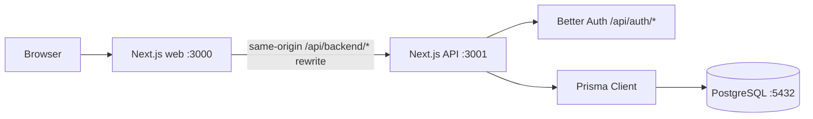

# Jelenlegi architektúra

Utolsó ellenőrzés: 2026-10-25
Állapot: konfigurációs alap; a háztartási pénzügyi funkciók még nincsenek megvalósítva.

Ez a dokumentum a repository jelenlegi állapotát írja le. A tervezett, de még nem elkészült részek külön jelölést kapnak, hogy későbbi módosításkor látható legyen, mi a tényleges architektúra.

## Repository-struktúra

```text
family_finance/
├── .agents/
│   └── skills/              Projekt-szintű Codex skillek
├── .codex/
│   ├── config.toml          Codex subagent concurrency configuration
│   └── agents/              Projekt-szintű architect, tester, reviewer, developer, designer, product-owner és git-workflow agentek
├── AGENTS.md               Shared project rules for coding agents
├── apps/
│   ├── web/                 Next.js webalkalmazás
│   └── api/                 Next.js API és hitelesítési végpontok
├── packages/
│   └── shared/              Kliensbiztos API-státusz szerződés és ellenőrzés
├── product-owner/
│   └── epics/               Termékepikek, taskokra bontás előtt
├── docs/                    Architektúra- és fejlesztői dokumentáció
├── skills-lock.json         A projekt-szintű skillek forrás- és hash-lockja
├── Dockerfile               Közös image-leírás, APP build argumentummal
├── docker-compose.yml       Web, API és PostgreSQL szolgáltatások
├── package.json             Workspace-szintű parancsok és verziók
├── pnpm-lock.yaml           Közös függőségi lockfile
└── pnpm-workspace.yaml      pnpm workspace beállítás
```

## Alkalmazások és adatfolyam



- A web és az API külön Next.js alkalmazásként és külön Compose-szolgáltatásként van beállítva.
- A web főoldalán backend-kapcsolatjelző van, amely a `/api/backend` útvonalon ellenőrzi az API állapotát.
- Az API és a web a `@household-finance/shared` csomag közös `BackendStatusResponse` típusát használja; a web a hálózati JSON-t a csomag kliensbiztos ellenőrző függvényével validálja.
- A web Next.js rewrite-ja az `/api/backend/*` kéréseket az API-ra továbbítja. Fejlesztéskor az alapcél `http://localhost:3001`; Compose alatt az `API_INTERNAL_URL=http://api:3001` érvényesül.
- A same-origin proxy elkerüli a böngésző CORS-korlátozását. Az API állapotvégpontja a `/` útvonalon, a Better Auth végpontjai a `/api/auth/*` alatt találhatók.
- A böngésző nem kapcsolódik közvetlenül a PostgreSQL-hez. Az adatbázis-hozzáférés az API feladata.
- Nincs beállítva reverse proxy. A Compose-portok jelenleg csak a localhost interfészre vannak kötve.

## Technológiák és verziók

| Elem | Beállított verzió | Használat |
|---|---:|---|
| Node.js | 24.22.1, `.nvmrc` szerint; Dockerben `node:24-alpine` | Fejlesztés és futtatás |
| pnpm | 11.25.0 | Workspace és függőségek |
| Docker Engine | 28.4.0 | Konténerfuttatás a fejlesztői gépen |
| Docker Compose | 2.39.2-desktop.1 | Helyi web, API és PostgreSQL szolgáltatások |
| Next.js | 16.4.3 | Web és API |
| React | 19.3.0 | Web UI |
| TypeScript | 5.9.3 | Web, API és közös csomag |
| ESLint | 9.39.5 | Web, API és közös TypeScript-forrás lintelése |
| Tailwind CSS | 4.3.3 | Web stílusok PostCSS-feldolgozással |
| Prisma ORM | 7.10.1 | API adatbázis-hozzáférés és migrációk |
| Prisma CLI | 7.10.1 | Sémaellenőrzés, kliensgenerálás és migrációk |
| PostgreSQL driver adapter | `@prisma/adapter-pg` 7.10.1 | Prisma kapcsolat PostgreSQL-hez |
| PostgreSQL driver | `pg` 8.23.1 | Node.js PostgreSQL kapcsolat |
| Better Auth | 1.7.12 | API hitelesítés email/jelszóval |
| Better Auth CLI | 1.7.12 | Auth séma generálása és ellenőrzése |
| Better Auth Prisma adapter | 1.7.12 | Auth-adatok tárolása Prisma segítségével |
| PostgreSQL image | 17-alpine | Compose adatbázis |

## Codex agentek és skillek

- A repository-szintű közös szabályok az `AGENTS.md` fájlban vannak.
- A `.codex/agents/` hét projektagentet tartalmaz: `architect`, `tester`, `reviewer`, `developer`, `designer`, `product_owner` és `git_workflow`. A szerepkörök és munkaszabályok agentenként a megfelelő TOML fájlban találhatók. A `reviewer` csak olvas, és kiemelten vizsgálja a biztonsági kockázatokat.
- A projekt-szintű, megosztott skillek az `.agents/skills/` alatt vannak; a `skills-lock.json` a külső forrásból telepített skillek forrását és tartalomhashét rögzíti. A `product-research` projektben karbantartott skill.
- A Codex multi-agent beállítás sessionönként legfeljebb hét párhuzamos subagentet enged.
- Az epic/task azonosítókhoz kötött branch-, commit- és PR-szabályokat a `docs/branching-strategy.md` írja le.

## Perzisztencia és konfiguráció

- A Compose `postgres` szolgáltatása a `postgres_data` nevű kötetet használja.
- A `DATABASE_URL` és a Better Auth beállításai a repository gyökerében lévő `.env` fájlból származnak. A `.env.example` csak minta; a titkos kulcsot helyben kell generálni.
- A Prisma konfiguráció az `apps/api/prisma.config.ts` fájlban van. A séma az `apps/api/prisma/schema.prisma` fájlban, az első migráció az `apps/api/prisma/migrations/` könyvtárban található.
- A Prisma Client generált fájljai az `apps/api/src/generated/prisma/` könyvtárba kerülnek; ez a könyvtár Git-ignore alatt van.
- A séma jelenleg csak a Better Auth `User`, `Session`, `Account` és `Verification` modelljeit tartalmazza.
- Az első `init` adatbázis-migráció létrejött, és a helyi PostgreSQL-adatbázisra alkalmazva lett.
- Fájlok privát tárolása, feltöltési kötet és mentési folyamat még nincs beállítva.

## Fejlesztői és konténeres indítás

- `./scripts/dev.sh` — ellenőrzi a Node.js, pnpm, Python 3 és Docker előfeltételeket, előkészíti a helyi `.env`-et, elindítja a PostgreSQL-t, ellenőrzi és alkalmazza a migrációt, majd indítja a webet `:3000` és az API-t `:3001` porton.
- `pnpm dev` — a web `:3000` és az API `:3001` indítása, ha az adatbázis és a migráció már készen áll.
- `pnpm build` — az API Turbopack-, majd a web Webpack-alapú production buildje. Mindkettő a közös TypeScript-forrást használja; a `packages/shared` csomagnak nincs külön build kimenete. A web buildje a Google Fonts letöltéséhez hálózatot igényel.
- `pnpm lint` — a web Next.js ESLint-ellenőrzése, majd az API és a `packages/shared/src` TypeScript ESLint-ellenőrzése; a generált Prisma-kód és Next.js buildkimenet kizárt.
- `pnpm typecheck` — külön TypeScript-ellenőrzés a `packages/shared`, `apps/api` és `apps/web` csomagokra.
- `docker compose up -d postgres` — csak az adatbázis indítása.
- `docker compose up --build -d` — web, API és adatbázis konténeres indítása.
- `pnpm --filter api prisma:generate` — Prisma Client generálása.
- `pnpm --filter api exec prisma migrate dev --name init` — kezdeti migráció létrehozása és alkalmazása.

A gyökér `Dockerfile` az `APP=web` vagy `APP=api` build argumentummal készít külön alkalmazásimage-et. A Dockerfile jelenleg a teljes workspace-függőségeket és forrásokat használja.

## Jelenleg még hiányzó funkciók

- Webes bejelentkezési felület és Better Auth klienskonfiguráció.
- Háztartások, tagságok, szerepkörök, kategóriák és pénzügyi adatmodellek.
- Verziózott `/api/v1` üzleti végpontok, validáció és egységes hibaválaszok.
- Receipt, bill, vehicle és document adatmodellek és üzleti folyamatok.
- E-mailes meghívás és emlékeztető-küldés.
- Privát dokumentumtár, reverse proxy, éles telepítési és visszaállítási folyamat.
- Automatizált tesztcsomag.

## Frissítési szabály

Ezt a dokumentumot frissítsd, amikor változik:

1. az alkalmazások, csomagok vagy szolgáltatások száma, felelőssége vagy kapcsolata;
2. a nyilvános port, útvonal, reverse proxy vagy adatfolyam;
3. a Node.js, pnpm, Next.js, Prisma, Better Auth vagy PostgreSQL fő verziója;
4. a Prisma séma, migrációs hely, adattárolás, fájlmentés vagy helyreállítás;
5. a hitelesítési mód, az API és a web közti bizalmi határ vagy a titkok kezelése;
6. a fejlesztői, buildelési vagy konténeres indítási parancs.

Minden frissítésnél módosítsd az „Utolsó ellenőrzés” dátumát. Ha a változás csak terv, ne írd át tényként: jelöld tervezettként, amíg a repositoryban ténylegesen meg nem jelenik.
