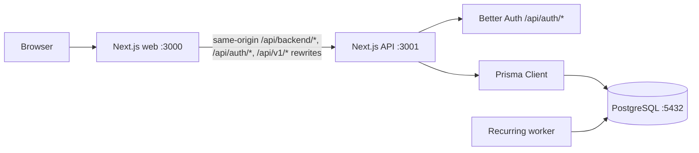

# Jelenlegi architektúra

Utolsó ellenőrzés: 2026-10-28
Állapot: a fiók/munkamenet, háztartás, kategória, főkönyvi írás/böngészés/archiválás, meghívókezelés és tagságkezelés kódja megvalósult a munkabranchben. A T03 írási és archiválási útvonalakhoz tartozó új migráció hozzáadva, helyi adatbázisra alkalmazása és a kézi ellenőrzés még hátravan. A T09 visszatérő költség adatmodellje, migrációja, havi workerének, szabálykezelő API-jának és Beállítások felületének kódja bekerült; a worker adatbázisos kézi ellenőrzése még hátravan.

Az EPIC-04-T01 dokumentum-metaadatséma, additív migráció, API-belső fájltároló modul és API-only Compose-kötet kódja bekerült. A migráció a helyi fejlesztői adatbázisra sikeresen alkalmazva; két szintetikus dokumentummal, elkülönített `/tmp` tárolóban a stage/finalize/open/exists és az olvasó reconcile kézi ellenőrzése sikeres volt. A Compose API-újraindítás és névvel ellátott kötet fennmaradása, valamint a DB idegenkulcs- és immutabilitási triggerének futásidejű próbája még hátravan. Az EPIC-04-T02 streaming, jogosított POST útvonal és az EPIC-04-T04 household-scoped, exact-byte duplikációkódja bekerült; a T04 párhuzamos API-ellenőrzése még hátravan.

Ez a dokumentum a repository jelenlegi állapotát írja le. A tervezett, de még nem elkészült részek külön jelölést kapnak, hogy későbbi módosításkor látható legyen, mi a tényleges architektúra.

## Repository-struktúra

```text
family_finance/
├── .agents/
│   └── skills/              Projekt-szintű Codex skillek
├── .codex/
│   ├── config.toml          Codex subagent concurrency configuration
│   └── agents/              Projekt-szintű architect, tester, reviewer, developer, designer, product-owner és git-workflow agentek
├── AGENTS.md               Shared project rules for coding agents
├── apps/
│   ├── web/                 Next.js webalkalmazás
│   └── api/                 Next.js API és hitelesítési végpontok
├── packages/
│   └── shared/              Kliensbiztos API-státusz szerződés és ellenőrzés
├── product-owner/
│   └── epics/               Termékepikek, taskokra bontás előtt
├── docs/                    Architektúra- és fejlesztői dokumentáció
├── skills-lock.json         A projekt-szintű skillek forrás- és hash-lockja
├── Dockerfile               Közös image-leírás, APP build argumentummal
├── docker-compose.yml       Web, API, recurring worker és PostgreSQL szolgáltatások
├── package.json             Workspace-szintű parancsok és verziók
├── pnpm-lock.yaml           Közös függőségi lockfile
└── pnpm-workspace.yaml      pnpm workspace beállítás
```

## Alkalmazások és adatfolyam



- A web és az API külön Next.js alkalmazásként és külön Compose-szolgáltatásként van beállítva. A havi fix költségek generálója az API image külön Compose-folyamata, böngészőnek nyitott port nélkül.
- A web főoldalán backend-kapcsolatjelző van, amely a `/api/backend` útvonalon ellenőrzi az API állapotát.
- Az API és a web a `@household-finance/shared` csomag közös `BackendStatusResponse` típusát használja; a web a hálózati JSON-t a csomag kliensbiztos ellenőrző függvényével validálja.
- A web Next.js rewrite-ja az `/api/backend/*`, `/api/auth/*` és `/api/v1/*` kéréseket az API-ra továbbítja. A böngészős dokumentumfeltöltés kivétel: a `POST /api/document-uploads/{householdId}` web Route Handler a teljes multipart body-t streamelve továbbítja a belső API `POST /api/v1/households/{householdId}/documents` útvonalára. A web handler csak a szükséges auth/Origin/multipart/idempotency fejléceket továbbítja, a 20 MiB + 64 KiB teljes kéréskorlát túllépésére `413`-at ad, míg az API marad a jogosultság, fájlellenőrzés és tárolás kizárólagos gazdája. A külön webes útvonal megkerüli a Next.js rewrite body-pufferkorlátját; a dokumentumlista GET továbbra is rewrite-on megy. Fejlesztéskor az alapcél `http://localhost:3001`; Compose alatt az `API_INTERNAL_URL=http://api:3001` érvényesül.
- A same-origin proxy elkerüli a böngésző CORS-korlátozását, és a Better Auth munkamenet-sütije a web originjén működik. Az API állapotvégpontja a `/` útvonalon, a Better Auth végpontjai a `/api/auth/*` alatt találhatók.
- A CSRF-ellenőrzött, cookie-munkamenetes módosító útvonalak, köztük a háztartás-, meghívó-, kategória- és főkönyvi POST/PATCH/DELETE műveletek, `application/json` tartalomtípust és pontosan engedélyezett `Origin` fejlécet követelnek meg. Hiányzó vagy érvénytelen `WEB_ORIGIN` esetén a módosítás zártan elutasított; az olvasó `GET` kérésekre ez az ellenőrzés nem vonatkozik. Fejlesztői módban a Better Auth és a CSRF-ellenőrzés a `WEB_ORIGIN` mellett a gép hálózati interfészeiről lekért, nem-loopback RFC1918 IPv4 címekhez tartozó pontos `http://<ip>:3000` origint is elfogadja. Éles módban kizárólag a konfigurált `WEB_ORIGIN` engedélyezett.
- A web a Better Auth 1.7.12 React kliensével regisztrál, jelentkeztet be és ki, valamint ellenőrzi a munkamenetet. Az API `GET /api/v1/me` végpontja a szerveroldali munkamenetből adja vissza a felhasználó alapadatait, vagy 401-et ad hitelesítés nélkül. A böngésző által küldött `userId` nem szolgál azonosításként.
- Az API `GET` és `POST /api/v1/households` végpontjai a Better Auth szerveroldali munkamenetéből veszik a felhasználóazonosítót. A listavégpont csak a felhasználó tagságait adja vissza. A létrehozás egy Prisma-tranzakcióban menti a háztartást, az első `OWNER` tagságot és a kilenc alapértelmezett kategóriát; a pénznem `RON`, más pénznemű kérés elutasításra kerül. Opcionálisan legfeljebb 20 `fixedCosts` szabályt is fogad a megnevezés, pontos RON összeg, seedelt kategóriakód, havi nap és kezdő hónap mezőkkel; a szabályokat és az esetleg már esedékes aktuális havi sorokat ugyanebben a tranzakcióban hozza létre. A fix költségek kihagyása továbbra is érvényes háztartás-létrehozás.
- Az EPIC-03-T01 `GET/POST /api/v1/households/[householdId]/categories` és `PATCH /api/v1/households/[householdId]/categories/[categoryId]` végpontjai a friss háztartási tagságot ellenőrzik. Mindhárom szerep olvashatja a saját háztartás kategóriáit, csak az OWNER hozhat létre, nevezhet át és archiválhat. Az archiválás puha: a kategória azonosítója és neve megmarad a történeti hivatkozásokhoz, a háztartás összefoglalója viszont csak az aktív kategóriákat adja vissza. A normalizált név háztartásonként egyedi, az archivált neveket is lefoglalja. A módosító kérésekre a same-origin JSON-védelem érvényes; minden válasz `no-store`.
- Az EPIC-03-T02 `POST /api/v1/households/[householdId]/ledger-entries` végpontja az aktuális `OWNER` vagy `MEMBER` tagságot és a same-origin JSON-kérést ellenőrzi. Csak kézi `INCOME`, `EXPENSE` vagy `REFUND` tételt fogad el pozitív, legfeljebb két tizedesjegyű RON összeggel, `YYYY-MM-DD` dátummal; kiadás és visszatérítés csak a saját háztartás aktív kategóriájához köthető. Az összeg az API-ban két tizedesjegyű string. A kliens által adott stabil UUID `Idempotency-Key` a kézi forrásazonosító; azonos szándék újraküldése a meglévő sort adja vissza, eltérő szándék azonos kulccsal `409`. A bizonylatforrást a nyilvános útvonal nem állíthatja be. A kategória írás közben zárolt, hogy archiválás közben se keletkezzen új tétel archivált kategóriával. A válaszok `no-store` fejlécesek.
- Az EPIC-03-T03 API edit/archive szelete a kollekciós GET alapnézetében csak aktív sorokat mutat; az `archived=true` szűrő az archiváltakat választja ki, míg `archived=false` vagy a paraméter hiánya az aktívakat jelenti. A részletútvonal OWNER/MEMBER/VIEWER számára olvasható és az előző állapotokat is visszaadja. A `PATCH` és `POST .../[entryId]/archive` csak friss `financial-write` jogosultsággal engedett, kizárólag aktív `MANUAL` sorokra; a PATCH kötelező `expectedUpdatedAt` mezővel védi a párhuzamos módosítást. Minden tényleges módosítás az előző teljes rekordállapotot, aktort, műveletet és időpontot append-only `LedgerEntryRevision` sorban rögzíti ugyanabban a tranzakcióban, amely a tételt módosítja vagy archiválja; PostgreSQL trigger tiltja a revíziók frissítését és törlését. Az ismételt archiválás idempotens és nem hoz létre új revíziót. A `RECEIPT` tételek változatlanok maradnak; hard delete és visszaállítás nincs ebben a szeletben. A mutációs és olvasási válaszok `no-store` fejlécesek.
- Az EPIC-03-T04 `GET /api/v1/households/[householdId]/dashboard?month=YYYY-MM` útvonala friss `read` jogosultsággal olvas, kizárólag az adott naptári hónap aktív kanonikus `LedgerEntry` sorait aggregálja, és `no-store` választ ad. A `@db.Date` hónaphatárai UTC dátumként illeszkednek a mentett háztartási naphoz. Az összesítés Prisma Decimal műveletekkel adja vissza a külön `income`, bruttó `expenses`, bruttó `refunds`, nettó `netExpenses` és kategóriánkénti bruttó/ nettó kiadásértékeket, mindet két tizedesjegyű stringként. A pozitív visszatérítés a saját hónapjában csökkenti a nettó kiadást, nem növeli a bevételt. A kategória-nézet a soft-archivált kategóriák megőrzött nevét is megjeleníti; kategória nélküli kiadás/visszatérítés `Kategória nélkül` összesítőbe kerül. Receipt-terméksorokat ez a végpont nem kérdez le, nincs benne költségkeret- vagy nettóvagyon-mutató.
- A web főoldali havi áttekintője a kiválasztott háztartás és hónap dashboardját kéri le, és a bevételt, bruttó kiadást, visszatérítést, nettó kiadást, valamint a kategóriaösszesítőt jeleníti meg. Az alapértelmezett hónapot `Europe/Bucharest` szerint választja. A T04 szintetikus futásidejű és kézi UI-ellenőrzése még nyitott.
- A T09 külön `recurring-worker` szolgáltatása induláskor és óránként végignézi az aktív szabályok esedékes hónapjait. A `Europe/Bucharest` naptári nap szerinti 29–31. napot a hónap végére igazítja, és csak esedékes hónapra hoz valódi `RECURRENT` főkönyvi sort. Minden szabály/hónap írása `Serializable` tranzakcióban, szabályzárral és DB-egyedi kulccsal történik; ütközéskor korlátos újrapróbálás vagy azonos előfordulás visszaolvasása következik. Egy hibás előfordulás nem állítja le a többi szabály pótlását. A worker pénzügyi adat nélküli állapotát és az utolsó sikeres sweep idejét a konténer `/tmp/recurring-worker-status.json` fájlja és a Compose healthcheck teszi láthatóvá; fatális hibánál nem nulla kilépés miatt a konténer újraindul. A worker az egészséges API-ra vár, így annak induláskori migrációja után kezd futni.
- A T09 `GET/POST /api/v1/households/[householdId]/recurring-expense-rules` útvonala háztartáson belül, lapozva listázza a szabályokat mindhárom szerepnek; új szabályt csak az `OWNER` hozhat létre, saját aktív kategóriával. Az új szabály aktuális, már esedékes előfordulása a szabállyal egy tranzakcióban jön létre. A `PATCH .../[ruleId]` és `POST .../[ruleId]/archive` csak friss `manage` jogosultsággal, same-origin JSON-kérésre, kötelező `expectedVersion` és UUID `Idempotency-Key` mellett módosít. Azonos szándék újraküldése a mentett szabályrevízió alapján visszajátszható; eltérő szándék vagy verzióütközés `409`.
- A T09 szabálymódosítása `Serializable` tranzakcióban kizárólag az adott háztartás `RECURRENT` és adott szabályhoz kötött, már létrejött főkönyvi sorainak összegét, kategóriáját, megnevezését és naptári napját írja át, az archivált sorokat is az archív állapot feloldása nélkül. A korábbi és új szabályállapot append-only `RecurringExpenseRuleRevision` sorban, minden ténylegesen változó tétel előző állapota ehhez kapcsolt `LedgerEntryRevision` sorban, ugyanabban a tranzakcióban marad meg. Legfeljebb 240 kapcsolt előfordulás korrigálható egy kérésben; több sor esetén `409 TOO_MANY_OCCURRENCES` érkezik, részleges módosítás nélkül. Az `archive` a szabályt `stoppedAt` mezővel puhán leállítja: a már létrejött tételek és audit megmaradnak, új előfordulás nem keletkezik.
- A `/beallitasok/fix-koltsegek` felület a kiválasztott háztartás lapozott szabályait és kategóriáit olvassa; minden tag megtekintheti őket, az OWNER létrehozhat, módosíthat és megerősítés után leállíthat szabályt. A módosító űrlap jelzi a korábbi havi sorokra gyakorolt hatást, a kezdő hónapot nem engedi átírni. A Napló listája a `RECURRENT` sorokat „Havi fix költség” forrásjelöléssel mutatja, a részletnézet pedig a Beállításokban található szabályra utal és megjeleníti a tétel revíziótörténetét.
- A későbbi, háztartásazonosítót célzó API-útvonalak újrahasználhatják az `authorizeHouseholdOperation` segédet. Minden híváskor a Better Auth munkamenetből származó felhasználóhoz friss `HouseholdMember` rekordot keres: munkamenet nélkül `401`, nemlétező vagy nem taghoz tartozó háztartásnál egységes `404`, a művelethez kevés szerepkörnél `403` a válasz. A `read` műveletet mindhárom (`OWNER`, `MEMBER`, `VIEWER`), a `financial-write` műveletet `OWNER` és `MEMBER`, a `manage` műveletet csak `OWNER` végezheti. A jelenlegi háztartáslista/létrehozás útvonalak továbbra is saját, munkamenet-alapú tagságszűrést használnak, mert nincs bennük cél-háztartásazonosító.
- A web bejelentkezés után a tagságlistából kínál háztartás-kiválasztást. A kiválasztott háztartás azonosítója `household-selection:v1` kulccsal, minimális böngészőoldali preferenciaként tárolódik; ez nem jogosultsági adat, a szerveroldali API mindig a munkamenet és tagság alapján ellenőriz.
- Az API `GET /api/v1/households/[householdId]` útvonala a `read` policyval friss tagságot ellenőriz, majd a háztartás nevét, RON pénznemét és a munkamenethez tartozó szerepet adja vissza. A `PATCH` ugyanazon az útvonalon `manage` jogosultságot kér, csak az 1–100 karakteres nevet fogadja el; a nem támogatott mezőket, így a `currency` módosítását is elutasítja. Mindkét válasz `Cache-Control: no-store` fejlécet kap.
- A háztartás panel a kiválasztott háztartás nevét, pénznemét és a tagságlistából származó szerepét mutatja; átnevező űrlapot csak `OWNER` szerepnél jelenít meg. Mentéskor az API szerveroldali policyja az irányadó, a panel pedig frissíti a nevet a sikeres válasz alapján. A pénznem rögzített `RON`, nincs pénznemválasztó.
- Az EPIC-02-T05 `HouseholdInvitation` Prisma-modellje és migrációja helyi fejlesztésben alkalmazva van. A háztartás alatti meghívó kiíró/listázó és visszavonó útvonalak a friss `manage` policyt használják, ami csak az `OWNER` szerepet engedi; 7 napos lejáratot, normalizált tájékoztató e-mail-címet, `MEMBER`/`VIEWER` szerepet, egyszer használatos véletlen tokent és adatbázisban csak SHA-256 token hash-t alkalmaznak. A nyers link csak a létrehozás válaszában szerepel; a függő meghívók listája nem adja vissza. A meghívólink alapcíme kötelező `WEB_ORIGIN` konfigurációból származik, és csak hiteles HTTP(S) origin lehet felhasználónév/jelszó, útvonal, query vagy fragment nélkül; nem-loopback hosztnál HTTPS kötelező, sima HTTP csak `localhost`, `127.0.0.1` vagy IPv6 `::1` loopback címen fogadható el. Hiányzó vagy hibás konfiguráció esetén a meghívás fail-closed módon elutasított, létrehozott meghívó és token nélkül. A kézi API- és felületellenőrzés szintetikus adatokkal sikeres volt.
- A web háztartás panelje a kiválasztott háztartáshoz kapcsolja az OWNER meghívókezelő felületet; szerep- vagy háztartásváltáskor a klienskomponens új példányként indul, ezért az egyszer megjelenő link állapota nem kerül át másik háztartáshoz vagy szerephez.
- Az EPIC-02-T06 meghívóelfogadó API-ja tokenből SHA-256 hasht készít, azonosítja a függő, le nem járt meghívót, majd egy tranzakcióban feltételesen elfogadott állapotba állítja és létrehozza a meghívott `MEMBER`/`VIEWER` tagságot. Már tag felhasználó `409` választ kap, a tagsága és szerepe nem változik, a meghívó pedig függő marad. A megosztott URL a tokent a `#token=` fragmentumban hordozza, amelyet a böngésző nem küld el a webkiszolgálónak; az elfogadóoldal a fragmentumot kliensoldalon olvassa és azonnal eltávolítja az előzményből. Az oldal `no-referrer` szabályt használ, és ugyanazon az oldalon biztosít bejelentkezést/regisztrációt, a tokent pedig nem tárolja böngészőtárban. Szintetikus kézi ellenőrzés igazolta a MEMBER/VIEWER elfogadást, a már tag 409-et, a token visszajátszását, visszavont/érvénytelen linket, egyidejű duplikált elfogadást és a token URL-ből eltávolítását; a lejárt link esete még ellenőrizetlen.
- Az EPIC-02-T07 `GET /api/v1/households/[householdId]/members` végpontja mindhárom szerepnek neveket és szerepeket ad; teljes e-mail-címeket csak az OWNER és az érintett tag kap. Az OWNER eltávolíthat másik tagot, saját kilépés a `DELETE .../members/me` végponton történik. Az egyedüli OWNER a kilépési kérésben megad egy meglévő MEMBER/VIEWER azonosítót; a céltag OWNER-ré előléptetése, az OWNER kiléptetése és a két audit-esemény ugyanabban a serializable tranzakcióban történik. Külön szerepmódosító végpont vagy szerepválasztó nincs. Az OWNER-számot érintő eltávolítás és kilépés serializable tranzakcióval védi az utolsó OWNER invariánst; ütközéskor `409` a válasz. A `HouseholdMemberAuditEvent` a háztartás, aktor, cél, művelet, előző/új szerep és időpont azonosítóit tárolja; a háztartás törlése a naplót is törli, e-mailt és tokent nem tárol. A tag API és UI kódja statikus ellenőrzést kapott; a szintetikus kézi ellenőrzés még függőben van.
- A Better Auth nyilvános base URL-je és engedélyezett originje a `WEB_ORIGIN` értékéből származik (`http://localhost:3000` alapértelmezés), mert a böngésző az auth végpontot a web proxyn keresztül éri el. Az API belső címe ettől független.
- Mobil kézi fejlesztői ellenőrzéshez a telefont és a fejlesztői Macet ugyanarra a Wi-Fi hálózatra kell csatlakoztatni, majd a telefonon a `http://<Mac privát IPv4 címe>:3000` címet megnyitni. A Next.js `allowedDevOrigins` beállítása fejlesztői módban csak a Mac aktuális, nem-loopback RFC1918 IPv4 interfészeinek hosztneveit engedi a fejlesztői eszközökhöz; a Better Auth és a CSRF-védelem ugyanennek a címkészletnek a `:3000` HTTP originjeit engedi. Ezek a kiegészítő engedélyek nem aktívak production környezetben, és nem használnak kérésből visszatükrözött hostnevet.
- A böngésző nem kapcsolódik közvetlenül a PostgreSQL-hez. Az adatbázis-hozzáférés az API feladata.
- Nincs beállítva reverse proxy. A Compose-portok jelenleg csak a localhost interfészre vannak kötve.

## Technológiák és verziók

| Elem | Beállított verzió | Használat |
|---|---:|---|
| Node.js | 24.22.1, `.nvmrc` szerint; Dockerben `node:24-alpine` | Fejlesztés és futtatás |
| pnpm | 11.25.0 | Workspace és függőségek |
| Docker Engine | 28.4.0 | Konténerfuttatás a fejlesztői gépen |
| Docker Compose | 2.39.2-desktop.1 | Helyi web, API, recurring worker és PostgreSQL szolgáltatások |
| Next.js | 16.4.3 | Web és API |
| React | 19.3.0 | Web UI |
| TypeScript | 5.9.3 | Web, API és közös csomag |
| ESLint | 9.39.5 | Web, API és közös TypeScript-forrás lintelése |
| Tailwind CSS | 4.3.3 | Web stílusok PostCSS-feldolgozással |
| Compresso.js | 1.0.2 | Helyi, kliensoldali dokumentumkép-előkészítés a webben |
| Prisma ORM | 7.10.1 | API adatbázis-hozzáférés és migrációk |
| Prisma CLI | 7.10.1 | Sémaellenőrzés, kliensgenerálás és migrációk |
| jiti | 2.7.0 | A külön TypeScript worker futtatása az API image-ben |
| PostgreSQL driver adapter | `@prisma/adapter-pg` 7.10.1 | Prisma kapcsolat PostgreSQL-hez |
| PostgreSQL driver | `pg` 8.23.1 | Node.js PostgreSQL kapcsolat |
| Better Auth | 1.7.12 | API hitelesítés és webes React kliens email/jelszóval |
| Better Auth CLI | 1.7.12 | Auth séma generálása és ellenőrzése |
| Better Auth Prisma adapter | 1.7.12 | Auth-adatok tárolása Prisma segítségével |
| PostgreSQL image | 17-alpine | Compose adatbázis |

## Codex agentek és skillek

- A repository-szintű közös szabályok az `AGENTS.md` fájlban vannak.
- A `.codex/agents/` hét projektagentet tartalmaz: `architect`, `tester`, `reviewer`, `developer`, `designer`, `product_owner` és `git_workflow`. A szerepkörök és munkaszabályok agentenként a megfelelő TOML fájlban találhatók. A `reviewer` csak olvas, és kiemelten vizsgálja a biztonsági kockázatokat.
- A projekt-szintű, megosztott skillek az `.agents/skills/` alatt vannak; a `skills-lock.json` a külső forrásból telepített skillek forrását és tartalomhashét rögzíti. A `product-research` projektben karbantartott skill.
- A Codex multi-agent beállítás sessionönként legfeljebb hét párhuzamos subagentet enged.
- Az epic/task azonosítókhoz kötött branch-, commit- és PR-szabályokat a `docs/branching-strategy.md` írja le.

## Perzisztencia és konfiguráció

- A Compose `postgres` szolgáltatása a `postgres_data` nevű kötetet használja. A privát dokumentumok `document_data` nevű tartós kötete kizárólag az API-hoz van csatolva a `/var/lib/household-finance/documents` útvonalon; a web és a recurring worker nem látja.
- A `DATABASE_URL` és a Better Auth beállításai a repository gyökerében lévő `.env` fájlból származnak. A `.env.example` csak minta; a titkos kulcsot helyben kell generálni.
- A Prisma konfiguráció az `apps/api/prisma.config.ts` fájlban van. A séma az `apps/api/prisma/schema.prisma` fájlban, a migrációk az `apps/api/prisma/migrations/` könyvtárban találhatók.
- A Prisma Client generált fájljai az `apps/api/src/generated/prisma/` könyvtárba kerülnek; ez a könyvtár Git-ignore alatt van.
- A séma a Better Auth `User`, `Session`, `Account` és `Verification` modelljei mellett tartalmazza a `Household`, `HouseholdMember`, `ExpenseCategory`, `LedgerEntry`, `LedgerEntryRevision`, `RecurringExpenseRule` és `RecurringExpenseRuleRevision` modelleket, valamint ezek szerep-, forrás- és auditművelet-enumait. Az elfogadott szerepek `OWNER`, `MEMBER` és `VIEWER`; a szerepcserélő migráció a korábbi `ADMIN` tagságokat `OWNER`-ré alakítja. A háztartások pénzneme alapértelmezetten `RON`; az API ezen kívül nem fogad el más pénznemet. Az `ExpenseCategory.normalizedName` és `archivedAt` mezőket a `20261026205615_manage_expense_categories` migráció adta hozzá. A `20261027062804_add_ron_ledger_entries` migráció a `LedgerEntry` táblát `DECIMAL(18,2)` összeggel, dátum típusú `occurredOn` mezővel, háztartáshoz kötött összetett kategória-idegen kulccsal, forrásonként egyedi `(sourceType, sourceId)` kulccsal és SQL CHECK megszorításokkal hozta létre. A T03 `20261027120000_ledger_entry_edit_archive` additív migrációja a ledger sorok `archivedAt` mezőjét és az append-only előzőállapot-revízió táblát adja hozzá. A T09 `20261027153000_recurring_expense_rules` migrációja a `RECURRENT` forrást, a háztartási és kategóriabeli összetett idegen kulcsú szabályt, a szabály/hónap egyedi valódi sorazonosságát, a forrás-CHECK-et és az append-only szabályauditot vezeti be; a meglévő főkönyvi revízió opcionálisan kapcsolható a szabályrevízióhoz. A helyi fejlesztői adatbázisra alkalmazott migrációk felsorolása az adatbázis aktuális állapotától függ.
- Az `init`, `20261026074859_add_households` és `20261026101718_restrict_household_roles` migráció létrejött; mind alkalmazva lett a helyi PostgreSQL-adatbázisra.
- A `Document` séma a háztartást, a feltöltő megőrzött azonosítóját, az opak belső tárolókulcsot, a `STAGING`/`AVAILABLE`/`FAILED` enumértékeket, MIME-típusokat, bájtméretet, SHA-256 hash-t és időbélyegeket tárolja. A T04 jelenlegi upload írási útvonala a teljes fájlt előbb privát ideiglenes fájlba spoololja, majd közvetlenül `AVAILABLE` sort hoz létre; nem ment DB-beli `STAGING` vagy `FAILED` sort. A reconciliation továbbra is felismeri a stale `STAGING` sorokat, valamint az orphan/missing fájlokat. A háztartás törlését az idegen kulcs korlátozza, az elérhető sor teljességét SQL CHECK védi. A `20261027170000_private_documents` additív migrációt a helyi fejlesztői adatbázisra sikeresen alkalmazták; az FK és az immutabilitási trigger működésének célzott futásidejű próbája még nyitott.
- A `20261030120000_preserve_failed_document_history` migráció az elérhetővé válás után hibásnak minősített dokumentumok történeti `availableAt` értékét és teljes tartalmi metaadatait megőrzi. `STAGING` sorhoz továbbra sem tartozhat `availableAt`; `AVAILABLE` és történeti időpontú `FAILED` sorhoz továbbra is kötelező a detektált MIME, méret és SHA-256. Az általános immutabilitási trigger változatlan; ez a migráció nem módosít dokumentumsort.
- A T02 első szeletének sémája nullable UUID `Document.uploadRequestKey` mezőt és `(householdId, uploadedByUserId, uploadRequestKey)` egyediséget, valamint `(userId, minuteStart)` kulcsú `DocumentUploadRateBucket` táblát tartalmaz. A `20261027180000_document_upload_guards` additív migrációt a helyi fejlesztői adatbázisra alkalmazták. Az API belső segédei PostgreSQL-atomikus, UTC-percenként legfeljebb 10 feltöltési próbálkozást számolnak felhasználónként, és csak az egyező, ténylegesen olvasható `AVAILABLE` dokumentumra kínálnak idempotens replay eredményt. A közös pontos Origin-ellenőrzés külön JSON és multipart tartalomtípus-szabállyal használható.
- A `POST /api/v1/households/{householdId}/documents` friss `OWNER`/`MEMBER` tagságot, engedélyezett Origint, multipart media type-ot, UUID `Idempotency-Key`-t és rate limitet ellenőriz a body olvasása előtt. A `busboy` 1.6.0-alapú Node.js parser egy fájlpartot streamel, legfeljebb 20 MiB fájlt és 20 MiB + 64 KiB teljes kérést fogad, majd JPEG/PNG/PDF/HEIC/HEIF signature/brand és deklarált MIME egyezést ellenőriz. A teljesen validált fájl először egy privát ideiglenes fájlba kerül; a `Document` sort csak ezután, közvetlenül `AVAILABLE` állapotban hozza létre az API. A PostgreSQL tranzakciós advisory lockja a háztartás és teljes SHA-256 alapján sorosítja az egyező hash keresését és az új sor beszúrását. A lock alatt az API időrendben betölti a háztartás `AVAILABLE` jelöltjeit, ellenőrzi a tárolt méretet és SHA-256 bájtokat, majd az első ellenőrzött dokumentum safe metadata-ját adja vissza `duplicate: true` jelzéssel; ha hash-egyező metadata mellett egyik fájl sem valid, általános feltöltési hibával leáll, nem mutat ID-t és nem hoz létre második rekordot. Ha nincs hash-egyező sor, ugyanabban a tranzakcióban hozza létre az új `AVAILABLE` dokumentumot. A régi duplikátum sorokat/fájlokat ez nem törli, a sémában már meglévő nem egyedi `(householdId, sha256)` indexet használja, új unique migráció nincs. Az `Idempotency-Key` egyedisége a háztartás és feltöltő alapján érvényesül. Az azonos kulcsú, azonos fingerprintű replay ugyanazt az ID-t adja; az azonos kulcs eltérő tartalomra `409`; azonos bájt másik kulccsal a meglévő household-dokumentum safe metadata-ja érkezik. Mivel a kulcs a teljes stream után, a rekord beszúrásakor foglalódik, konkurens azonos kulcsú kérések mind spoololhatnak; a korai `UPLOAD_IN_PROGRESS` időzítés nem garantált, de a végleges replay/fingerprint konfliktus megmarad. Más háztartások önálló példányt hozhatnak létre. A response `no-store`, és nem ad hash-t, storage key-t vagy fájlrendszerutat. A formátum- és méretprofil ideiglenes MVP technikai döntés.
- A web főoldali kamera- és Fájlkezelés-feltöltőfelülete a közös kliensoldali segédben, helyben telepített `compresso.js` 1.0.2 csomaggal készíti elő a 500 KiB-nál nagyobb képeket a same-origin POST előtt. A 500 KiB puha cél; a képszöveg olvashatósága érdekében a legfeljebb 2400 px hosszabb élű, 0,82-es JPEG-kimenet nagyobb méretben is menthető a szerver 20 MiB-os korlátjáig. A PDF változatlan, a tényleges fájlméret látható, az azonos próbálkozás ugyanazokat a feltöltendő bájtokat és UUID-kulcsot használja. A böngésző csak a privát API-nak küldi el az eredményt; a csomag nem használ külső képfeldolgozó szolgáltatást vagy CDN-scriptet. HEIC/HEIF dekódolás Safari/iOS alatt natív, más böngészőben a helyben csomagolt opcionális dekódertől és annak CSP-támogatásától függ; a szerver végső MIME/szignatúra-validációja változatlan.
- Az API belső `private-document-storage` modulja fejlesztéskor a Git által ignorált `data/documents` útvonalat használja, productionben pedig kizárólag a `DOCUMENT_STORAGE_ROOT=/var/lib/household-finance/documents` mountot fogadja el. A fájlnevet a kliens nem választhatja meg tárolási útként: 256 bites véletlen kulcsból képzett lapos fájlnév, privát jogosultságok és symlink-ellenőrzés védi. A modul stage/finalize/open/exists/reconcile műveleteket ad; a final fájl exclusive hard linkkel és könyvtárszinkronizálással készül el, majd a PostgreSQL tranzakciós advisory lock alatt futó household/hash lookup vagy `AVAILABLE` DB-sor beszúrás következik. A lock az egyező tartalom összes alkalmazásszerver közti írását sorba rendezi, de alkalmazási szerződés: a `Document` minden új írójának ugyanazt kell használnia. Hash metadata-egyezés esetén csak bájtellenőrzött, elérhető fájl adható vissza; régi duplikátumok érintetlenek maradnak, ellenőrizhetetlen tartalomnál a kérés fail-closed. Ez nem közös fájlrendszer/DB tranzakció. Bizonytalan DB-hiba esetén a final fájl megmarad, mert az adatbázis insert commitja nem állapítható meg biztonsággal. Az orphan temporary/final fájlokat a reconciliation jelzi; a jelenlegi upload writer új `STAGING`/`FAILED` `Document` sort nem ment. Az API-konténer a migráció után, a szerver indítása előtt olvasó reconciliationt futtat, és az eltérések darabszámát naplózza. A `pnpm --filter api documents:reconcile -- --details` kezelői parancs soronként is kiírja az eltéréseket, de nem javítja vagy törli őket. Külső mentési és visszaállítási folyamat még nincs.

## Fejlesztői és konténeres indítás

- `./scripts/dev.sh` — ellenőrzi a Node.js, pnpm, Python 3 és Docker előfeltételeket, előkészíti a helyi `.env`-et, Compose-ban elindítja a PostgreSQL-t és a privát `document_data` kötetet használó API-t, megvárja az API egészséges állapotát, majd csak a webet indítja helyben `:3000` porton. A `Ctrl+C` csak a helyi webet állítja le; a konténerek futva maradnak.
- `pnpm dev` — a web és a helyi API együttes indítása; a jelenlegi közös tesztadatbázissal nem használható, mert a helyi API másik dokumentumtárba ír. Helyi API hot reloadhoz külön fejlesztői adatbázis és privát tár kell az ADR-0004 szerint.
- `pnpm build` — az API Turbopack-, majd a web Webpack-alapú production buildje. Mindkettő a közös TypeScript-forrást használja; a `packages/shared` csomagnak nincs külön build kimenete. A web buildje a Google Fonts letöltéséhez hálózatot igényel.
- `pnpm lint` — a web Next.js ESLint-ellenőrzése, majd az API és a `packages/shared/src` TypeScript ESLint-ellenőrzése; a generált Prisma-kód és Next.js buildkimenet kizárt.
- `pnpm typecheck` — külön TypeScript-ellenőrzés a `packages/shared`, `apps/api` és `apps/web` csomagokra.
- `docker compose up -d postgres` — csak az adatbázis indítása.
- `docker compose up --build -d` — web, API, recurring worker és adatbázis konténeres indítása.
- `pnpm --filter api prisma:generate` — Prisma Client generálása.
- `pnpm --filter api worker:recurring` — a külön havi generáló helyi indítása alkalmazott migráció után.
- `pnpm --filter api exec prisma migrate dev --name <migration-name>` — fejlesztői migráció létrehozása és alkalmazása.

A gyökér `Dockerfile` az `APP=web` vagy `APP=api` build argumentummal készít külön alkalmazásimage-et. A Dockerfile a teljes workspace-függőségeket és forrásokat használja; a helyi Next.js-kimenet, TypeScript-cache és generált Prisma-kód kimarad a build kontextusából. A Prisma Client az API image-ben generálódik.

Az API buildje csak a buildparancs idejére kap szintetikus adatbázis-URL-t és véletlen auth titkot, adatbázis-kapcsolat nélkül; ezek nem kerülnek az image környezeti változói közé. Futáskor a Compose adja a konfigurációt. A web proxycélja már buildkor `http://api:3001`, mert a Next.js a rewrite-okat buildkor rögzíti.

Az API konténer indításkor `prisma migrate deploy` parancsot futtat, és csak sikeres migráció után indítja a Next.js szervert. A Compose az API-t a PostgreSQL health checkjéhez köti. Migrációs hiba esetén az API 1-es kóddal kilép, az `unless-stopped` restart policy újrapróbálja az indítást; a szerver nem válhat egészségessé, a hiba az API logjában látható. Az újraindítás a már alkalmazott migrációkat nem futtatja újra. A `docker compose up --build -d --wait` a szolgáltatások egészséges állapotáig vár.

A migráció után az API az olvasó dokumentum-reconciliationt is lefuttatja; konfigurációs vagy adatbázishibánál az indítás megszakad. Talált eltéréseknél a napló jelzése után indul tovább, mert a dokumentumolvasás külön hash- és méretellenőrzéssel zárva marad.

Az API image még az alapértelmezett root felhasználóval fut; nem root futtatásra csak a kötet tulajdonjogának és a Prisma startupnak konténeres ellenőrzése után váltunk.

## Jelenleg még hiányzó funkciók

- A kategóriakezelés felhasználói felületének kézi, több szerepkörös ellenőrzése; az API és adatmodell megvalósult.
- A T09 havi workerének adatbázisos kézi ellenőrzése.
- Az EPIC-03-T04 havi dashboard szintetikus havi/kategória-egyeztetése, idegen háztartás elleni és reszponzív kézi ellenőrzése; további későbbi pénzügyi folyamatok.
- További verziózott `/api/v1` üzleti végpontok, validáció és egységes hibaválaszok a `me` végponton túl.
- Az EPIC-02 háztartásbeállítás, meghívó kiadása/visszavonása, meghívó elfogadása és tagságkezelés az aktuális munkabranchben készült. A T04/T05/T06 szintetikus kézi ellenőrzése sikeres; a T07 ellenőrzése hátravan. A T01 kategória- és a T02/T03 főkönyvi API megvalósult; a T03 módosító/archiváló migráció alkalmazása és kézi ellenőrzése még hátravan.
- Receipt, bill és vehicle adatmodellek, valamint dokumentum feltöltési/olvasási üzleti útvonalak.
- E-mailes meghívás és emlékeztető-küldés.
- A privát dokumentumtár Compose API-újraindítás/named-volume fennmaradási és DB FK/immutabilitási triggerének kézi próbája, továbbá a reverse proxy, éles telepítési és visszaállítási folyamat.
- Automatizált tesztcsomag. Az EPIC-02-T01 és EPIC-02-T02 jelenleg szintetikus adatokkal végzett kézi böngészős/API-ellenőrzésre épül.

## Frissítési szabály

Ezt a dokumentumot frissítsd, amikor változik:

1. az alkalmazások, csomagok vagy szolgáltatások száma, felelőssége vagy kapcsolata;
2. a nyilvános port, útvonal, reverse proxy vagy adatfolyam;
3. a Node.js, pnpm, Next.js, Prisma, Better Auth vagy PostgreSQL fő verziója;
4. a Prisma séma, migrációs hely, adattárolás, fájlmentés vagy helyreállítás;
5. a hitelesítési mód, az API és a web közti bizalmi határ vagy a titkok kezelése;
6. a fejlesztői, buildelési vagy konténeres indítási parancs.

Minden frissítésnél módosítsd az „Utolsó ellenőrzés” dátumát. Ha a változás csak terv, ne írd át tényként: jelöld tervezettként, amíg a repositoryban ténylegesen meg nem jelenik.
